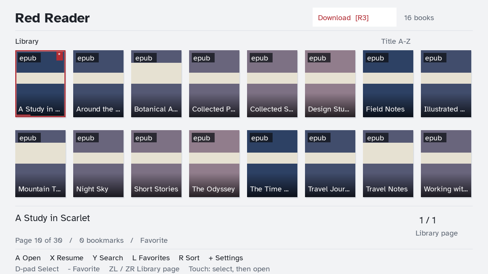
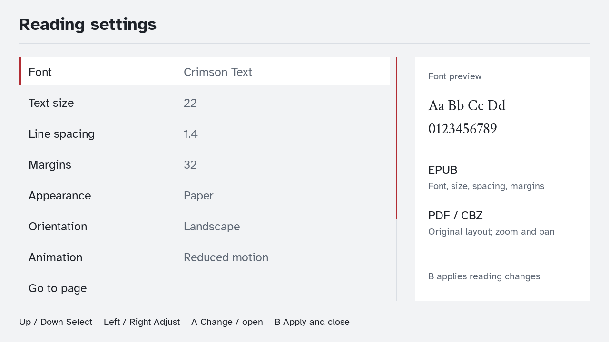

# Red Reader 2.3.0

2.0.1 fixes a startup crash in the first `TTF_OpenFont` call. MuPDF and SDL_ttf now resolve font-shaping symbols from portlibs HarfBuzz, avoiding MuPDF's context-bound private allocator. Keep `-lharfbuzz` before `-lmupdf-third` in the link order. After a Switch build, run `python tests/check_font_link.py` to check the actual linker map; desktop UI tests alone cannot detect this conflict.

Nintendo Switch ebook reader for **full RAM / application mode**. Supports EPUB, PDF, CBZ, and CBR. Place books in `sdmc:/lib`; subfolders are scanned up to eight levels deep, with a 10,000-book limit.

Launch Homebrew Menu by holding **R** while starting a game, then launch Red Reader. Album/applet launches show a full RAM requirement screen instead of loading books.

## Interface and workflow

- Sixteen full-cover library cards in an 8-column, 2-row grid with an edge-aligned selection outline and a short emphasis fade, title overlays, reading progress, and favorites. All cards use a 132 x 176 (3:4) frame, center-cropped without stretching. Selected book details appear below the shelf.
- EPUB covers are read from EPUB 2 metadata, EPUB 3 cover-image properties, cover guide/XHTML/SVG wrappers, the first spine wrapper, or cover filenames. A rendered first page is the final fallback. PDF uses its first page; comics use their first naturally sorted image.
- CBZ and CBR comics load directly from ZIP/RAR archives with natural page order (1, 2, 10). Nothing is extracted to SD; originals remain untouched.
- Search by title, sort alphabetically or by recently read, filter favorites, and resume the last book.
- Reading view with optional controls, page counter, progress line, eased 220 ms page crossfades, and reduced-motion mode. The old page stays opaque beneath the incoming page to avoid a brightness dip.
- Paper, Sepia, and Night appearances. Night mode inverts page colors, including images in PDF/CBZ/CBR files.
- Landscape and rotated portrait reading.
- EPUB fonts: Publisher, Atkinson Hyperlegible, Crimson Text, and Lusitana. Adjust text size, line spacing, and margins. The settings panel previews the selected font.
- PDF/CBZ/CBR retain their original layout and fonts; use zoom and pan instead of EPUB formatting controls.
- Up to 100 bookmarks per book, a chapter list when supplied by the document, and direct page-number entry.
- Saves reading progress automatically after a page is displayed, and on return to the library or normal exit. Settings and favorites persist.




The screenshots use synthetic test records. Interface text is limited to book information, controls, settings, and status/error messages.

## Direct-link downloads

Click **Download** in the library header or press **R3** (right-stick click). Press **A** to enter an HTTP/HTTPS link, then choose a filename ending in `.epub`, `.pdf`, `.cbz`, or `.cbr`. The file is saved to `sdmc:/lib` and automatically appears in the library. Existing books and partial files are never intentionally overwritten; choose a new name if one exists.

The download screen displays transferred size, total/percentage when the server supplies a size, speed, and an estimated remaining time. **X** cancels an active transfer or opens a completed book. **B** returns to the library; downloading continues while browsing or reading. Returning with R3 shows the current transfer. Only one download runs at a time.

A separate worker handles networking, SD writes, and file-type checks. Downloads use a `.part` staging file; failed or cancelled transfers remove their own staging file. After an interrupted power-off, an abandoned `.part` file may need removing manually or a different filename. Direct links requiring sign-in, cookies, or an HTML landing page are not supported. TLS verification stays enabled; an optional CA bundle may be placed at `sdmc:/lib/save/cacert.pem` if required by the installed curl backend. EPUB/CBZ/CBR archive structure and PDF signatures are checked before adding a download; this is not a guarantee that every page of a damaged book will render.

## Controls

| Screen | Controls |
| --- | --- |
| Library | Left/Right: adjacent book. Up/Down: move one row. A: open. X: resume last book. Y: search. B: clear search/filter. L: favorites filter. R: sort. Minus: toggle selected favorite. ZL/ZR: jump sixteen books. Plus: settings. R3: downloads. |
| Download | A: enter link and filename. X: cancel / open completed book. B: return to library. |
| Reading | A / Right / R: next page. Left / L: previous page. B: library. Y: add/remove current bookmark. X: show/hide controls. Minus: cycle appearance. Plus: settings. |
| EPUB reading | ZL/ZR: decrease/increase text size. |
| PDF/CBZ/CBR reading | ZL/ZR: decrease/increase zoom (1–3×). Left stick: pan. Up/Down also pan vertically. |
| Settings | Up/Down: select. Left/Right or A: adjust. B/Plus: apply and return. Go to page, Chapters, Bookmarks, Library, and Exit are further down the list. |
| Chapters | Up/Down: select. A: jump. B: reader. |
| Bookmarks | Up/Down: select. A: jump. X: remove. B: reader. |

Touch: swipe left/right to turn pages; tap the left/right quarter to turn pages and the center to show/hide controls. Pinch to zoom PDF/CBZ/CBR pages and drag to pan while zoomed. In the library, tap to select, tap the selected card to open, and swipe horizontally or vertically to page through the shelf. Touch coordinates follow portrait rotation.

## Performance and memory

Document opening, page rasterization, chapter resolution, and cover decoding run on one background worker. Only that worker owns MuPDF documents and its context. SDL texture creation and drawing stay on the main thread.

- Library startup scans filenames without decoding every cover.
- Cover decoding waits briefly after selection, loads the selected cover first, then fills visible cards one at a time. Up to twenty textures are retained; visible covers are protected from eviction.
- Previous/current/next raster pages are cached, with a maximum of three pages and a 32 MiB pixel-cache budget.
- EPUB/PDF adjacent pages are prefetched when no requested render is waiting. Comic pages load on demand and share the bounded pixel cache.
- New requests replace pending requests. Results carry generation IDs, preventing old pages from replacing the newly selected book/page.
- MuPDF's resource store is capped at 96 MiB. Render dimensions are capped at 2048 pixels per axis. Failed EPUB/PDF page renders retry at a lower resolution.
- UI text uses a bounded 128-texture cache rather than recreating textures every frame.

These are implementation limits, not measured frame-rate or latency claims. Large or complex documents can still take time to open. Active MuPDF calls finish before worker shutdown; a corrupt or unusually complex document may delay exit.

## Persistence and compatibility

State is stored in `sdmc:/lib/save/reader.json`, keyed by each book's full path. Writes use a temporary file and backup; startup can recover from the backup. The original `global_setting.dat` and per-book `.save` files are read when migrating from version 1.

Page numbers can change when an EPUB is reflowed. After a layout change, reading positions and bookmarks use approximate document progress to find the corresponding page. This is not paragraph-level anchoring. Renaming or moving a book changes its state key.

Custom fonts replace publisher CSS for predictable font selection. Publisher mode keeps the document's own font choices. Lusitana has regular/bold faces; its italic styles use those same faces. Password-protected or DRM-protected books are not supported. Missing or invalid chapter links are omitted.

CBR supports the RAR variants handled by libarchive, including RAR5; encrypted and multi-volume comics are not supported. Comic images are limited to 32 MiB compressed-entry data each and archives to 20,000 entries. Solid RAR files can be slower to seek because earlier compressed data may need decoding again. Missing covers use a format placeholder.

## Code structure

| Module | Responsibility |
| --- | --- |
| `source/main.cpp` | Initialization, full RAM gate, input/frame loop, shutdown |
| `source/model.cpp`, `include/model.hpp` | Book/style data, search/sort, position mapping, EPUB font CSS |
| `source/storage.cpp` | Library scan, state migration/persistence, Switch keyboard |
| `source/download.cpp` | Background download, transfer progress, cancellation, staged file validation and library insertion |
| `source/engine.cpp` | MuPDF worker, chapter links, raster cache, prefetch, page colors |
| `source/document_assets.cpp` | EPUB cover metadata, archive image loading, natural comic page order |
| `source/reader.cpp` | Render requests/results, texture handoff, bookmarks, reading transitions |
| `source/input.cpp` | Controller/touch controls, settings and navigation workflow |
| `source/ui.cpp` | Library, reader, settings, lists, text cache and animations |

## Build

Requires devkitPro/devkitA64, libnx, and Switch portlibs for MuPDF, curl, libarchive, Expat, SDL2, SDL2_ttf and the libraries listed in `Makefile`. The installed toolchain used here includes MuPDF 1.17.0; the EPUB font CSS and chapter-link handling target that API.

```sh
export DEVKITPRO=/opt/devkitpro
export DEVKITA64=$DEVKITPRO/devkitA64
make -j2
```

Copy `Red_Reader.nro` to your Switch homebrew directory. Fonts are included in RomFS. Original background artwork remains in the repository but is not loaded by the new UI.

## Validation

`tests/asset_tests.cpp` exercises the actual archive/cover code against generated EPUB 2/3, SVG wrapper, relative-path, ZIP and RAR5 fixtures. `tests/generate_asset_fixtures.py` creates the fixtures (RAR5 generation requires WinRAR). An optional EPUB path checks the supplied Word Bearers file without copying it into the repository. The native archive test found its declared `cover.jpg` (212,607 bytes). This validates cover selection/archive decoding, not Switch rendering.

Portable model tests:

```sh
c++ -std=c++17 -Iinclude tests/model_tests.cpp source/model.cpp -o build/model_tests
./build/model_tests
```

`tests/desktop_tests.cpp` runs the production input, reader-controller, and SDL renderer with mocked storage/document services. It checks search, favorites, bookmarks, deferred chapter navigation, page remapping, stale results, zoom, portrait rendering, themes, and the full RAM gate. Desktop SDL2, SDL2_ttf and SDL2_image are required; compile with `RR_DESKTOP` and `tests/stubs` ahead of platform headers. `tests/run-desktop.ps1` runs the Windows checks with a supplied Zig compiler and SDL DLL directory.

`tests/generate_fixtures.py` creates small synthetic EPUB/PDF files for decoder and hardware checks. Desktop workflow tests do not validate actual MuPDF decoding or measure Switch performance. The font-face loading and EPUB chapter-link handling were checked against the bundled MuPDF version's source.

Download URL/filename checks, file-type validation, and download-screen controls are covered by host tests. Actual networking/TLS, SD failures, and cancellation timing still require Switch testing.

On a Switch, verify EPUB custom fonts/bold/italic, font-size reflow, chapter links, bookmarks across restarts, landscape/portrait touch controls, PDF/CBZ/CBR zoom, large scanned books, corrupt files, SD write failures, and normal exit. Rendering may need device-specific tuning.

## Third-party notices

Fonts are distributed under the SIL Open Font License; license files are in `licenses/`. Sources: [Atkinson Hyperlegible](https://github.com/google/fonts/tree/main/ofl/atkinsonhyperlegible), [Crimson Text](https://github.com/google/fonts/tree/main/ofl/crimsontext), [Lusitana](https://github.com/google/fonts/tree/main/ofl/lusitana). The nlohmann/json MIT license is also included. MuPDF and the other existing linked dependencies retain their own licensing requirements.
